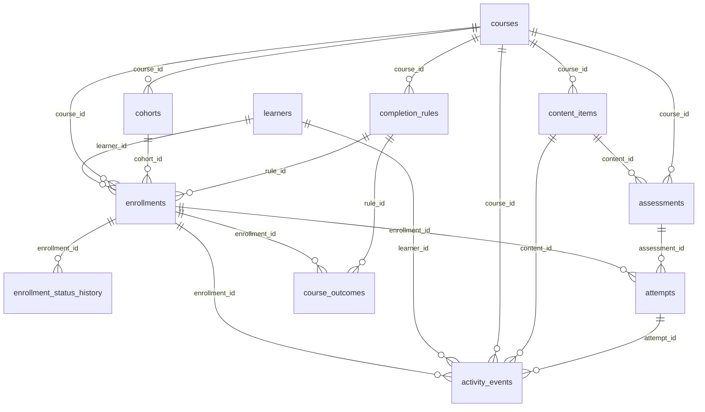

# Data dictionary

Generated from `lms_synth/schema.py`; the validator checks every delivered table against it.

Conventions: timestamps are ISO-8601 UTC `YYYY-MM-DDTHH:MM:SSZ`; dates `YYYY-MM-DD`; booleans `true`/`false`; an empty CSV cell means NULL. `Required` = must be non-empty. Units are listed where relevant.

## ID / nomenclature conventions

| Entity | Pattern | Notes |
|---|---|---|
| Learner | `LRN-000001` | 6-digit zero-padded counter, immutable |
| Course | `CRS-000001` | |
| Enrollment | `ENR-<learner-id>-<course-id>` | e.g. `ENR-LRN-000001-CRS-000042`; natural key, one per learner and course |
| ActivityEvent | `EVT-<enrollment-id>-000001` | per-enrollment counter in **ingestion order** (ties: generation order) |
| Assessment | `ASM-2026-000001` | year token is fixed to the data-model release year 2026 (spec) |
| *Cohort* | `COH-000001` | extra convention (spec silent) |
| *ContentItem* | `CNT-000001` | extra convention |
| *CompletionRule* | `RUL-000001` | extra convention; odd = version 1, even = version 2 of a course |
| *Attempt* | `ATT-<enrollment-id>-<assessment seq>-<attempt no>` | extra convention |
| *EnrollmentStatusHistory* | `ESH-<enrollment-id>-<seq>` | extra convention |
| *CourseOutcome* | `OUT-<enrollment-id>` | extra convention, 1:1 with enrollment |

## Entity relationships



Learner N:M Course is resolved by **Enrollment** (bridge with state); Enrollment N:M ContentItem by **ActivityEvent**; Enrollment N:M Assessment by **Attempt**. ContentItem is self-referencing (module -> item). `activity_events.attempt_id`, `content_items.parent_content_id` and `courses.retired_date` are the optional relationships.

## Tables

### learners

A person with a platform account. Master data, generated first.

- **Primary key:** `learner_id`
- **Foreign keys:** none
- **Cardinality:** Learner 1:N Enrollment (N:M with Course via Enrollment)
- **Lifecycle / effective dates:** Static master record; no lifecycle in this model.

| field | type | req | allowed values | unit | unique | validation rule / description |
|---|---|---|---|---|---|---|
| `learner_id` | string | yes | LRN-\d{6} |  | yes | Primary key. zero-padded counter, immutable |
| `signup_date` | date | yes | 2025-01-01..as-of |  |  | Account creation date. <= date of the learner's first enrollment (7-90 days earlier) |
| `country_code` | string | yes | AE,AU,BR,CA,DE,GB,IN,NG,SG,US |  |  | ISO-3166 alpha-2 country. |
| `timezone` | string | yes | Asia/Kolkata; America/New_York; America/Chicago; America/Los_Angeles; Europe/London; Asia/Dubai; Asia/Singapore; Australia/Sydney; Europe/Berlin; America/Sao_Paulo; Africa/Lagos; America/Toronto |  |  | IANA timezone of the learner. must agree with utc_offset_minutes |
| `utc_offset_minutes` | integer | yes | -720..840 | minutes |  | Standard (non-DST) UTC offset used to derive learner-local dates. DST is deliberately ignored; see README limitations |
| `primary_device` | string | yes | desktop,mobile,mixed |  |  | Most-used device class. |
| `acquisition_channel` | string | yes | organic,referral,employer,partner |  |  | How the learner arrived. |

### courses

A course in the catalogue.

- **Primary key:** `course_id`
- **Foreign keys:** none
- **Cardinality:** Course 1:N ContentItem, Course 1:N Cohort, Course 1:N CompletionRule
- **Lifecycle / effective dates:** published -> retired (terminal).

| field | type | req | allowed values | unit | unique | validation rule / description |
|---|---|---|---|---|---|---|
| `course_id` | string | yes | CRS-\d{6} |  | yes | Primary key. |
| `title` | string | yes |  |  |  | Display title. |
| `category` | string | yes | Data Science,Software Engineering,Business,Design,Health,Languages,Finance,Mathematics |  |  | Subject area. |
| `level` | string | yes | beginner,intermediate,advanced |  |  | Difficulty level. |
| `duration_weeks` | integer | yes | 4,6,8,10,12 | weeks |  | Planned length of a cohort run. |
| `delivery_mode` | string | yes | instructor_led,self_paced |  |  | Delivery mode. |
| `published_date` | date | yes |  |  |  | Effective-from date of the course and its content. |
| `status` | string | yes | published,retired |  |  | Lifecycle state at the data cut-off. retired iff retired_date <= as-of date |
| `retired_date` | date | no |  |  |  | Effective-to date. required iff status = retired; no cohort starts within 14 days of it |
| `n_modules` | integer | yes |  |  |  | Number of module rows in content_items. = count of content_items(type=module) |
| `n_items` | integer | yes |  |  |  | Number of leaf content items. = count of content_items with depth 2 |
| `total_est_minutes` | integer | yes |  | minutes |  | Sum of est_minutes of leaf items. = sum(content_items.est_minutes, depth 2) |

### content_items

Course content hierarchy: module rows (depth 1) and leaf items (depth 2).

- **Primary key:** `content_id`
- **Foreign keys:** `course_id` -> `courses.course_id`, `parent_content_id` -> `content_items.content_id`
- **Cardinality:** ContentItem N:1 Course; ContentItem 1:N ContentItem (module -> items); ContentItem N:M Enrollment via ActivityEvent

| field | type | req | allowed values | unit | unique | validation rule / description |
|---|---|---|---|---|---|---|
| `content_id` | string | yes | CNT-\d{6} |  | yes | Primary key. |
| `course_id` | string | yes |  |  |  | Owning course. |
| `parent_content_id` | string | no |  |  |  | Module row for leaf items; null for modules. null iff content_type=module |
| `content_type` | string | yes | video,reading,discussion,quiz,assignment,exam,module |  |  | Type. |
| `title` | string | yes |  |  |  | Display title. |
| `sequence_no` | integer | yes | >=1 |  |  | Position within parent (modules: within course). unique within (course_id, parent_content_id) |
| `depth` | integer | yes | 1,2 |  |  | Hierarchy depth. |
| `week_number` | integer | yes | 1..duration_weeks | week index |  | Planned week in the cohort schedule. |
| `is_required` | boolean | yes | true,false |  |  | Counts towards the CompletionRule. module: true iff any child required; discussions are never required |
| `est_minutes` | integer | yes | >=0 | minutes |  | Expected effort. module = sum of its children (derived) |

### assessments

Graded item attached 1:1 to a quiz/assignment/exam content item.

- **Primary key:** `assessment_id`
- **Foreign keys:** `content_id` -> `content_items.content_id`, `course_id` -> `courses.course_id`
- **Cardinality:** Assessment 1:1 ContentItem; Assessment 1:N Attempt

| field | type | req | allowed values | unit | unique | validation rule / description |
|---|---|---|---|---|---|---|
| `assessment_id` | string | yes | ASM-2026-\d{6} |  | yes | Primary key. |
| `content_id` | string | yes |  |  | yes | The content item that hosts the assessment. content_type in (quiz, assignment, exam) and matches assessment_type |
| `course_id` | string | yes |  |  |  | Owning course. = content_items.course_id of content_id |
| `assessment_type` | string | yes | quiz,assignment,exam |  |  | Type. |
| `max_score` | integer | yes | 100 | points |  | Maximum score. |
| `passing_score` | integer | yes | quiz 60, assignment 65, exam 70 | points |  | Minimum score to pass. |
| `max_attempts` | integer | yes | quiz 3, assignment 2, exam 2 |  |  | Attempts allowed. |
| `is_required` | boolean | yes |  |  |  | Must be passed for completion. = content_items.is_required |
| `weight_pct` | decimal | yes | 0..100 | percent |  | Weight in the course final score. required assessments of a course sum to exactly 100; others 0 |
| `difficulty_rating` | integer | yes | 1..5 |  |  | Published difficulty (noisy proxy of true difficulty). |

### completion_rules

Versioned course completion rule with effective dates.

- **Primary key:** `rule_id`
- **Foreign keys:** `course_id` -> `courses.course_id`
- **Cardinality:** CompletionRule N:1 Course; CompletionRule 1:N Enrollment (rule snapshot at cohort start)

| field | type | req | allowed values | unit | unique | validation rule / description |
|---|---|---|---|---|---|---|
| `rule_id` | string | yes | RUL-\d{6} |  | yes | Primary key. |
| `course_id` | string | yes |  |  |  | Course the rule applies to. |
| `rule_version` | integer | yes | 1,2 |  |  | Version number. unique within course |
| `effective_from` | date | yes |  |  |  | First day the version applies (by cohort start date). |
| `effective_to` | date | no |  |  |  | Last day; null = open ended. versions of a course are contiguous and non-overlapping |
| `min_required_content_pct` | integer | yes | 70..95 | percent |  | Share of required video/reading/discussion items that must be completed. |
| `assessment_policy` | string | yes | all_required_passed |  |  | Assessment condition. all_required_passed: every required assessment has a submitted attempt with score >= passing_score |
| `completion_window_days` | integer | yes | 30 | days |  | Days after cohort end during which progress still counts. |

### cohorts

A scheduled run of a course; enrollments belong to exactly one cohort.

- **Primary key:** `cohort_id`
- **Foreign keys:** `course_id` -> `courses.course_id`
- **Cardinality:** Cohort N:1 Course; Cohort 1:N Enrollment
- **Lifecycle / effective dates:** planned -> active -> grace -> closed (snapshot at as-of date).

| field | type | req | allowed values | unit | unique | validation rule / description |
|---|---|---|---|---|---|---|
| `cohort_id` | string | yes | COH-\d{6} |  | yes | Primary key. |
| `course_id` | string | yes |  |  |  | Course being run. |
| `cohort_label` | string | yes | \d{4}-W\d{2} |  |  | ISO year-week of the start. |
| `start_date` | date | yes |  |  |  | First day (always a Monday). |
| `end_date` | date | yes |  |  |  | Last scheduled day. = start_date + 7*duration_weeks - 1 |
| `access_end_date` | date | yes |  |  |  | Last day content/assessments can be used and progress counts. = end_date + 30 |
| `instructor_code` | string | no | INS-\d{4} |  |  | External instructor reference (instructor_led only). null iff delivery_mode = self_paced |
| `capacity` | integer | yes | 40..200 |  |  | Seat limit. |
| `status` | string | yes | planned,active,grace,closed |  |  | State at the data cut-off. planned: start>as-of; active: start<=as-of<=end; grace: end<as-of<=access_end; closed: after |

### enrollments

Bridge between Learner and Course (N:M), placed in one Cohort. Current state is derived from enrollment_status_history.

- **Primary key:** `enrollment_id`
- **Foreign keys:** `learner_id` -> `learners.learner_id`, `course_id` -> `courses.course_id`, `cohort_id` -> `cohorts.cohort_id`, `rule_id` -> `completion_rules.rule_id`
- **Cardinality:** Learner N:M Course via Enrollment; Enrollment 1:N ActivityEvent, 1:N Attempt, 1:N StatusHistory, 1:1 CourseOutcome
- **Lifecycle / effective dates:** enrolled -> active -> completed | dropped | expired; enrolled -> dropped | expired. History is append-only.

| field | type | req | allowed values | unit | unique | validation rule / description |
|---|---|---|---|---|---|---|
| `enrollment_id` | string | yes | ENR-LRN-\d{6}-CRS-\d{6} |  | yes | Primary key. ENR-<learner_id>-<course_id>; one per learner and course |
| `learner_id` | string | yes |  |  |  | Learner. |
| `course_id` | string | yes |  |  |  | Course. = cohorts.course_id of cohort_id |
| `cohort_id` | string | yes |  |  |  | Cohort. |
| `rule_id` | string | yes |  |  |  | Completion rule version in force at the cohort start date. rule effective on cohorts.start_date |
| `enrolled_at` | timestamp | yes |  |  |  | ISO-8601 UTC, YYYY-MM-DDTHH:MM:SSZ >= learners.signup_date; <= cohort access_end; <= as-of |
| `current_status` | string | yes | enrolled,active,completed,dropped,expired |  |  | Latest status in the history. = last row of enrollment_status_history |
| `status_updated_at` | timestamp | yes |  |  |  | ISO-8601 UTC, YYYY-MM-DDTHH:MM:SSZ = effective_from of the last history row |

### enrollment_status_history

Append-only log of enrollment state changes (history is never overwritten).

- **Primary key:** `history_id`
- **Foreign keys:** `enrollment_id` -> `enrollments.enrollment_id`
- **Cardinality:** StatusHistory N:1 Enrollment
- **Lifecycle / effective dates:** Transitions limited to schema.TRANSITIONS.

| field | type | req | allowed values | unit | unique | validation rule / description |
|---|---|---|---|---|---|---|
| `history_id` | string | yes | ESH-<enrollment_id>-\d{2} |  | yes | Primary key. |
| `enrollment_id` | string | yes |  |  |  | Enrollment. |
| `status` | string | yes | enrolled,active,completed,dropped,expired |  |  | New status. |
| `previous_status` | string | no |  |  |  | Status before the change; null for the first row. |
| `effective_from` | timestamp | yes |  |  |  | ISO-8601 UTC, YYYY-MM-DDTHH:MM:SSZ non-decreasing within enrollment |
| `change_source` | string | yes | learner,system |  |  | Who caused the change. |

### attempts

One try at an assessment by an enrollment (repeated attempts allowed up to max_attempts).

- **Primary key:** `attempt_id`
- **Foreign keys:** `enrollment_id` -> `enrollments.enrollment_id`, `assessment_id` -> `assessments.assessment_id`
- **Cardinality:** Attempt N:1 Enrollment, N:1 Assessment (N:M bridge between them)

| field | type | req | allowed values | unit | unique | validation rule / description |
|---|---|---|---|---|---|---|
| `attempt_id` | string | yes | ATT-<enrollment_id>-\d{6}-\d{2} |  | yes | Primary key. ATT-<enrollment_id>-<assessment seq>-<attempt_no> |
| `enrollment_id` | string | yes |  |  |  | Enrollment. |
| `assessment_id` | string | yes |  |  |  | Assessment. |
| `attempt_no` | integer | yes | 1..max_attempts |  |  | 1-based counter. consecutive per (enrollment, assessment) |
| `started_at_utc` | timestamp | yes |  |  |  | ISO-8601 UTC, YYYY-MM-DDTHH:MM:SSZ |
| `submitted_at_utc` | timestamp | no |  |  |  | ISO-8601 UTC, YYYY-MM-DDTHH:MM:SSZ null iff status=abandoned; >= started_at_utc |
| `status` | string | yes | submitted,abandoned |  |  | Outcome of the try. |
| `score` | decimal | no | 0..max_score | points |  | Score achieved. null iff abandoned |
| `passed` | boolean | no | true,false |  |  | Derived: score >= passing_score. null iff abandoned |
| `duration_minutes` | decimal | no |  | minutes |  | submitted - started. |

### activity_events

Learner activity as received by the platform, one row per delivery (duplicates are possible).

- **Primary key:** `event_id`
- **Foreign keys:** `enrollment_id` -> `enrollments.enrollment_id`, `learner_id` -> `learners.learner_id`, `course_id` -> `courses.course_id`, `content_id` -> `content_items.content_id`, `attempt_id` -> `attempts.attempt_id`
- **Cardinality:** ActivityEvent N:1 Enrollment, N:1 ContentItem (the N:M bridge between them)

| field | type | req | allowed values | unit | unique | validation rule / description |
|---|---|---|---|---|---|---|
| `event_id` | string | yes | EVT-<enrollment_id>-\d{6} |  | yes | Primary key, assigned at ingestion in arrival order. |
| `enrollment_id` | string | yes |  |  |  | Enrollment (ENR-<learner>-<course>). should resolve to enrollments; unresolved ids are the 'unenrolled activity' exception |
| `learner_id` | string | yes |  |  |  | Learner. |
| `course_id` | string | yes |  |  |  | Course. |
| `content_id` | string | yes |  |  |  | Content item touched. must belong to course_id |
| `event_type` | string | yes | content_view,video_play,video_complete,content_complete,discussion_post,assessment_start,assessment_submit |  |  | Type. |
| `event_time_utc` | timestamp | yes |  |  |  | When the activity happened, as normalised by the server. ISO-8601 UTC, YYYY-MM-DDTHH:MM:SSZ should be <= ingested_at_utc |
| `device_utc_offset_minutes` | integer | no |  | minutes |  | UTC offset reported by the device. null if the device did not report it |
| `ingested_at_utc` | timestamp | yes |  |  |  | When the platform received the event. ISO-8601 UTC, YYYY-MM-DDTHH:MM:SSZ <= as-of; late/offline events have large lag |
| `platform` | string | yes | web,mobile_app,mobile_offline_sync |  |  | Source. |
| `client_event_id` | string | yes | [0-9a-f]{16} |  |  | Idempotency key generated on the client; retries reuse it. distinct real events never share it |
| `duration_seconds` | integer | no | >=0 | seconds |  | Time spent. null for content_view and assessment_start |
| `attempt_id` | string | no |  |  |  | Attempt for assessment_start/assessment_submit events. non-null iff event_type in (assessment_start, assessment_submit) |

### course_outcomes

One derived outcome per enrollment, evaluated from deduplicated activity, attempts and the applicable rule.

- **Primary key:** `outcome_id`
- **Foreign keys:** `enrollment_id` -> `enrollments.enrollment_id`, `rule_id` -> `completion_rules.rule_id`
- **Cardinality:** CourseOutcome 1:1 Enrollment

| field | type | req | allowed values | unit | unique | validation rule / description |
|---|---|---|---|---|---|---|
| `outcome_id` | string | yes | OUT-<enrollment_id> |  | yes | Primary key. |
| `enrollment_id` | string | yes |  |  | yes | Enrollment (1:1). |
| `rule_id` | string | yes |  |  |  | Rule applied. |
| `required_content_total` | integer | yes |  |  |  | Required video/reading/discussion items in the course. |
| `required_content_completed` | integer | yes |  |  |  | Distinct required items with a completion event (deduplicated, valid enrollment, within window). |
| `content_completion_pct` | decimal | yes | 0..100 | percent |  | completed / total * 100. |
| `required_assessments_total` | integer | yes |  |  |  | Required assessments in the course. |
| `required_assessments_passed` | integer | yes |  |  |  | Required assessments with a passing submitted attempt. |
| `final_score` | decimal | yes | 0..100 | points |  | sum(weight_pct * best submitted score) / 100 over required assessments (0 if never submitted). |
| `rule_met_at_utc` | timestamp | no |  |  |  | Time both rule conditions first held. max(content threshold reached, last required assessment passed); null if not met |
| `outcome_status` | string | yes | completed,in_progress,withdrawn,not_completed |  |  | Rule-based outcome at the cut-off. completed iff rule met; else withdrawn if dropped; else not_completed once access window closed; else in_progress |
| `completed_date` | date | no |  |  |  | UTC date of rule_met_at_utc. null unless completed |
| `platform_completed_at_utc` | timestamp | no |  |  |  | When the platform marked the enrollment completed (history). |
| `completion_conflict` | boolean | yes | true,false |  |  | Platform completion recorded although the rule was not met, or before it was met. |
| `evaluated_as_of_utc` | timestamp | yes |  |  |  | Data cut-off used for evaluation. |

## Enrollment state machine

```
(new) -> enrolled -> active -> completed
                 \-> dropped   (also from enrolled)
                 \-> expired   (also from enrolled)
```
completed / dropped / expired are terminal. History is append-only: a state change adds a row, nothing is updated.

## Labelled exception classes (ground truth)

These are written to `ground_truth/ground_truth.csv` with columns `ground_truth_id`, `record_type`, `record_id`, `issue_type`, `subtype`, `related_record_id`, `observed_value`, `true_value`, `expected_decision`. Input tables carry **no** label column.

| issue_type | subtype | What is injected | Expected decision |
|---|---|---|---|
| `duplicate_event` | `retry_duplicate` | A second delivery of a real event (same `client_event_id`, new `event_id`, later `ingested_at_utc`). Offline-sync events are duplicated ~5x more often than online ones. | drop, keep first ingested |
| `activity_unenrolled` | `never_enrolled` | Event whose `ENR-<learner>-<course>` has no enrollment record | exclude from engagement |
| `activity_unenrolled` | `before_enrollment` | Valid enrollment, but event_time precedes `enrolled_at` | exclude from engagement |
| `completion_before_required_assessment` | `required_assessment_not_passed` | Platform marked the enrollment completed once the content threshold was met although a required assessment was never passed | do not record completion |
| `completion_before_required_assessment` | `required_assessment_passed_later` | Platform completion time is the content-threshold time, > 1 h before the last required assessment was passed | completion time = rule_met_at |
| `timezone_shift` | `offset_present` / `offset_missing` | `event_time_utc` carries the device's local clock time instead of UTC (shifted by the learner's UTC offset), which moves the event to the next/previous learner-local day; device offset is reported in 40% of cases, missing in 60% | reassign to the true local date |

Also in `ground_truth/`: `ground_truth_learners.csv` (hidden engagement segment, true ability, true inactivity) - latent variables used to simulate behaviour; never feature columns.
